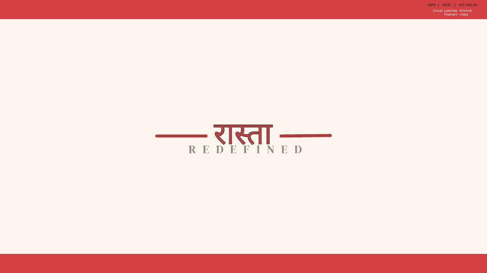
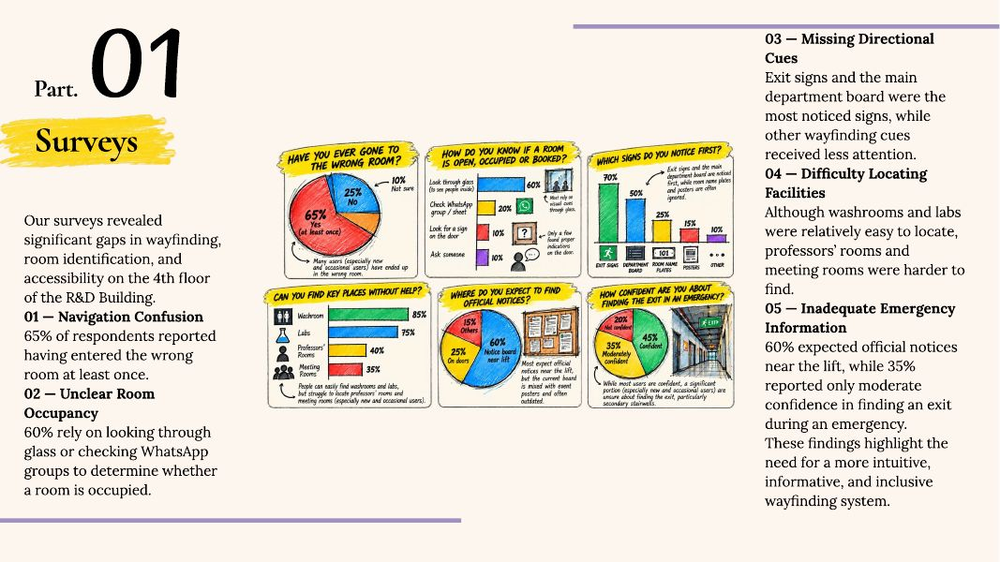
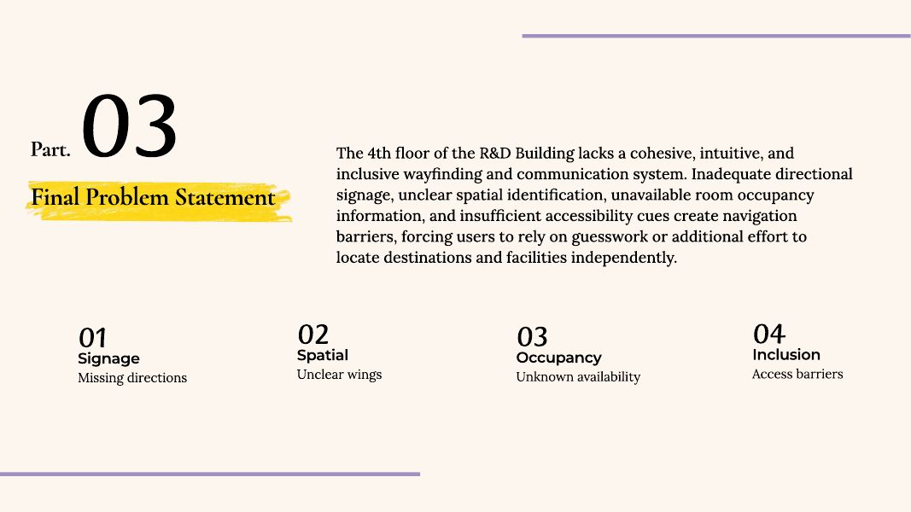
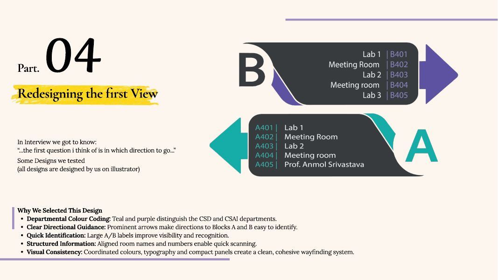
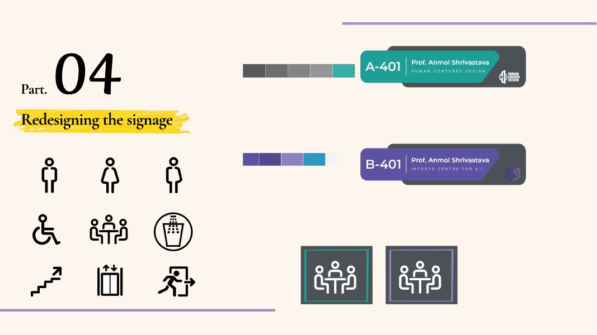
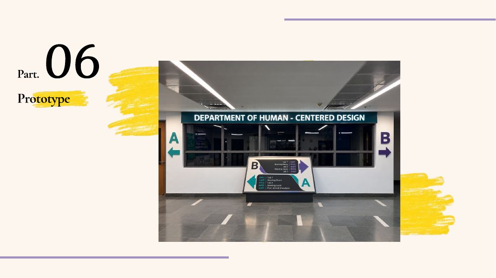
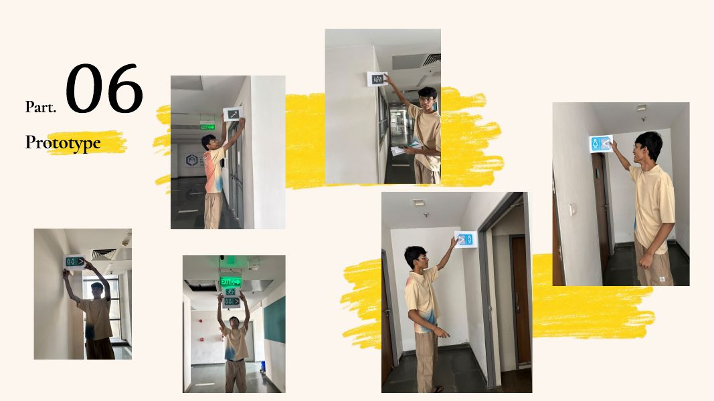
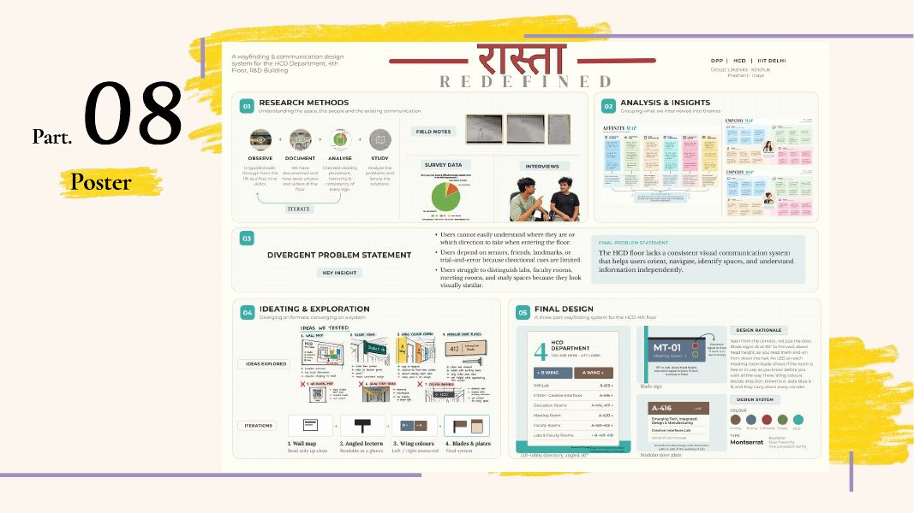

# Raasta Redefined: A Wayfinding System for the 4th Floor, R&D Building

**Course:** DPP (Design Practicum), Human-Centered Design, IIIT Delhi · **Team:** four students · **Tools:** Adobe Illustrator, Figma
## Summary

The 4th floor of the R&D Building at IIIT Delhi houses two departments, split into Wing A (Human-Centered Design) and Wing B (Centre for Artificial Intelligence). Visitors could not tell which way to go, which wing a room belonged to, or whether a room was free. We researched how people actually navigate the floor, defined the problem through four iterations, and designed a unified, accessibility-aware wayfinding system, then prototyped the signs in place.

## 1. Research

**Methods:** site observation, walkthroughs, spatial mapping, interviews and a survey, followed by thematic analysis. Interviews covered three visitor types: frequent, first-time and occasional.

**Survey findings**

| Finding | Result |
|---|---|
| Entered the wrong room at least once | 65% |
| Check room occupancy by looking through glass or asking on WhatsApp groups | 60% |
| Had difficulty locating the exit plan | 70% |
| Expected official notices near the lift | 60% |
| Only moderately confident of finding an exit in an emergency | 35% |

Professors' rooms and meeting rooms were the hardest destinations to find. Exit signs and the main department board were the only cues most people noticed.

## 2. Problems identified

1. **No clear emergency exit plan** at the entrance
2. **No floor map or wing identification**: even with a lab number like A102 or B102, people could not tell which wing or direction to take
3. **No room occupancy information** from the lobby, forcing wasted trips to check
4. **Inadequate directional signage** to stairs, washrooms and drinking water. Newcomers found only one of the three staircases.
5. **Signage out of reach for wheelchair users**: the fire exit plan and information boards sit at about 1,680 mm, while the accessibility guideline we followed gives 1,300 mm as a good vision height
6. **No tactile guidance** for visually impaired users

## 3. Defining the problem

The problem statement went through four iterations: identifying the problem, understanding user difficulties, expanding the scope, then integrating the findings. The final version frames four gaps (signage, spatial identification, occupancy and inclusion) as the absence of one cohesive, intuitive and inclusive wayfinding system.

## 4. Design decisions

| Decision | Choice and reasoning |
|---|---|
| **Colour coding** | Teal for Wing A (HCD) and purple for Wing B (Centre for AI), so people can tell the two departments apart at a glance |
| **Typeface** | Montserrat. The Indian Harmonised Guidelines for Universal Accessibility (2021) recommend legible sans-serif type for signage. Montserrat gives clear letterforms, a visual hierarchy through weights, and one consistent family across all sign types. |
| **First view** | A glass, backlit board at the middle of the floor, inclined at 30° at about 1,200 mm, so the first question visitors ask ("which direction?") is answered on entry. The height follows the Guidelines (Ch. 5, Signage and Information Systems) for wheelchair users. |
| **Exit signage** | Illuminated and green, following the National Building Code of India 2016, Part 4, Section 3.4.7.4 |
| **Tactile guidance** | Braille on signs, placed at accessible height per the same Guidelines |

**Testing the first-view board.** We designed three versions in Illustrator. Two were rejected: one separated the arrows from the A/B identifiers, and the other used overlapping diagonal panels with oversized circular labels that competed with the information. The selected design won on colour-coded departments, prominent arrows toward Blocks A and B, large A/B labels, aligned room names and numbers, and consistency in colour and type.

## 5. Signage system

A consistent icon set (washrooms, accessible facilities, stairs, lifts, meeting rooms, exits) and department-coloured room boards, scaled across both wings.

## 6. Prototype

We built the signs and placed them in the building to see how they read in context.

## 7. Poster

## Standards referenced

- Harmonised Guidelines and Standards for Universal Accessibility in India (2021), Ministry of Housing and Urban Affairs, Chapter 5: Signage and Information Systems
- National Building Code of India 2016, Part 4: Fire and Life Safety, Section 3.4.7.4 (Exit Signage)
- Accessibility Standards and Guidelines for Civil Aviation (cited for the 1,300 mm vision height)

---
[← Back to Design Works](../README.md)
